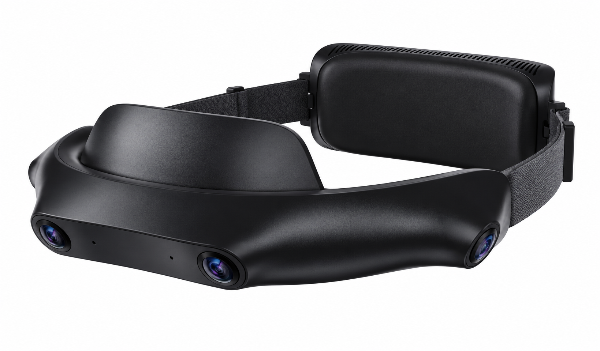
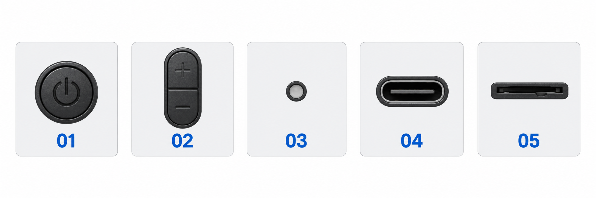

# Device Overview

> **Status: Review draft; content pending verification.** Resolve all “To confirm” items before publishing as user instructions.

[Guide home](index.md) · [简体中文](../zh/device-overview.md)

SynerMind Ego 4 is a four-camera head-worn device for egocentric data collection. Use this page to identify the parts you need during operation.

## Product illustration

Redrawn from the competitor's appearance: curved front camera housing, side headband, forehead padding, and rear module. The far-side camera may be hidden in this perspective.

## Controls and ports legend

| Number | Name | Identification |
| --- | --- | --- |
| 01 | Power button | Power symbol; exact power operations require device verification |
| 02 | Volume / function controls | Plus/minus or function controls; shortcuts require verification |
| 03 | Status indicator | Status display; gray in the illustration does not indicate an operating state |
| 04 | USB Type-C port | Connection functions and electrical specifications depend on the shipped version |
| 05 | TF card slot | Storage access; verify whether this design is used in the shipped device |

> **Reference draft:** The product image is redrawn from the competitor's image. Control and port categories come from its component descriptions; their order in the legend does not indicate actual positions on Ego 4. Verify shape, count, layout, port functions, and indicator behavior against the shipped device.

## Identify these parts

| Part or marking | What you need to know |
| --- | --- |
| Cameras | The location and direction of each lens; keep them clear when worn |
| Fit adjustments | How to secure and adjust the device comfortably |
| Controls | The actual power, start, and stop operations |
| Status indicators | How to distinguish idle, recording, saving, and error states |
| Power and data ports | The purpose of each port and the cables it accepts |
| Storage location | How to connect or remove storage as instructed for your kit |
| Device label | Model, SN, and information needed for support |

> **To confirm:** Reference illustrations have been added. Add annotated front, side, and fitting photos of the shipped device to verify actual positions. Port specifications, button count, and indicator colors and meanings are not yet confirmed.

## Why the serial number matters

The SN identifies the device, links it to recordings, and helps with support. For Collecta uploads, check that the SN in the session matches the registered device.

## Choosing accessories

Use the accessories specified for your kit or confirmed as compatible. Refer to the final list in [Specifications & Compatibility](specifications.md) for optional accessories and connection instructions.

Next: [Your First Recording](quick-start.md).
