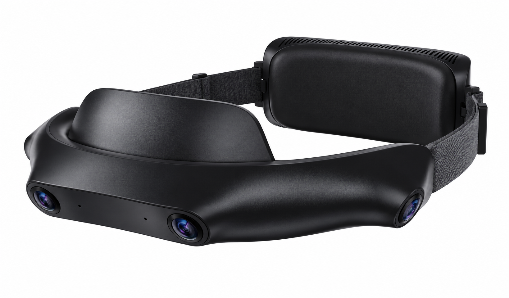

# SynerMind Ego 4 User Guide

> **Status: Review draft; content pending verification.** Resolve all “To confirm” items before publishing as user instructions.

[Guide home](index.md) · [简体中文](../zh/index.md)

*Reference product illustration; final appearance depends on the shipped device.*

Choose the page that matches what you need to do.

| I want to… | Start here |
| --- | --- |
| Use the device for the first time | [Your First Recording](quick-start.md) |
| Prepare for today's recording | [Recording Guide](recording.md) |
| Export, check, or upload data | [Export & Verify](export.md) |
| Fix a device or data issue | [Troubleshooting](troubleshooting.md) |

## All topics

### Quick Start

- [Your First Recording](quick-start.md)

### Device & Recording

- [Device Overview](device-overview.md)
- [Recording Guide](recording.md)
- [Settings & Updates](settings-updates.md)

### Working with Data

- [Export & Verify](export.md)
- [Files & Data Formats](data-formats.md)

### Troubleshooting & Support

- [Troubleshooting](troubleshooting.md)
- [Contact Support](support.md)

### Reference

- [Specifications & Compatibility](specifications.md)
- [Safety & Care](safety-care.md)
