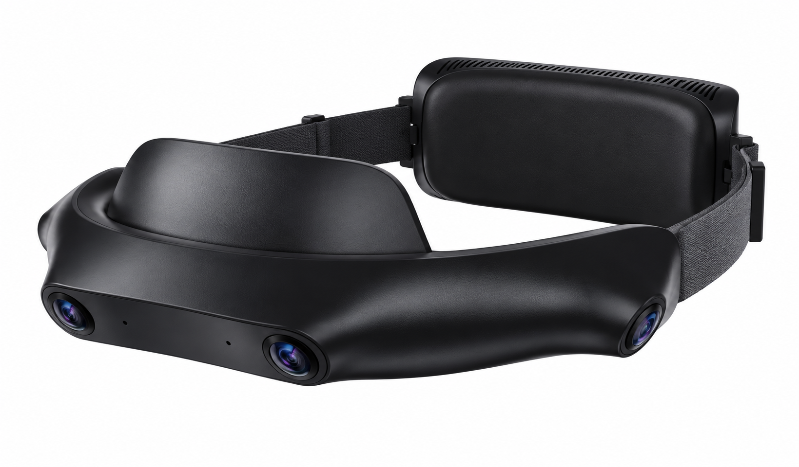
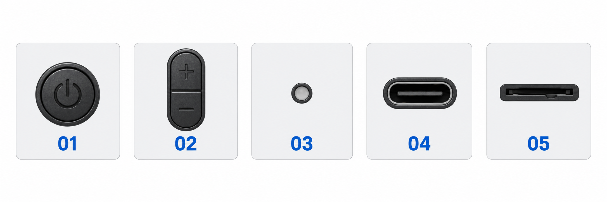

# 认识设备

> **文档状态：评审初稿，内容待核验。** “待确认”项需核实后才能作为正式用户说明。

[用户指南首页](index.md) · [English](../en/device-overview.md)

SynerMind Ego 4 是一款用于第一视角数据采集的四目头戴式设备。本页帮助你找到使用时需要识别的部件。

## 产品外观示意

参考竞品外观重绘：前部弧形相机机身、侧边头带、额部衬垫和后部模块。透视图中远侧镜头可能被遮挡。

## 按键与接口识别图

| 编号 | 名称 | 识别要点 |
| --- | --- | --- |
| 01 | 电源键 | 电源符号；具体开关机操作待实物确认 |
| 02 | 音量／功能键 | 加减或功能控制；快捷操作待确认 |
| 03 | 状态指示灯 | 状态显示；图中灰色不代表具体运行状态 |
| 04 | USB Type-C 接口 | 连接用途及电气规格按交付版本确认 |
| 05 | TF 卡槽 | 存储介质入口；是否采用此方案按实物确认 |

> **参考草图：** 产品图依据竞品图片重绘；按键及接口类别参考其部件说明，识别图中的排列不表示它们在 Ego 4 上的实际位置。外形、数量、布局、接口功能与灯效需按交付设备校正。

## 先认清这些位置

| 部件或标识 | 使用时需要知道什么 |
| --- | --- |
| 镜头 | 各路镜头的位置和朝向；佩戴后不要遮挡 |
| 佩戴调节部件 | 怎样固定和调节，使设备稳定且舒适 |
| 操作按键 | 开关机、开始和停止录制的实际操作 |
| 状态指示 | 怎样区分待机、录制、保存和异常 |
| 供电与数据接口 | 各接口的用途及允许使用的线缆 |
| 存储位置 | 如何按交付说明连接或取出存储介质 |
| 设备标签 | 型号、SN 及支持时需要提供的信息 |

> **待确认：** 已加入竞品参考草图；仍需补充交付设备正面、侧面和佩戴照片，校正实际位置。接口规格、按键数量、指示灯颜色与含义尚未确认。

## 序列号有什么用

SN 用于区分设备、关联采集数据和定位支持问题。使用 Collecta 上传时，请确认会话中的 SN 与已登记设备一致。

## 配件怎么选

使用交付套装指定或已确认兼容的配件。可选配件及其连接方法以[规格与兼容性](specifications.md)的正式清单为准。

下一步：[完成首次采集](quick-start.md)。
