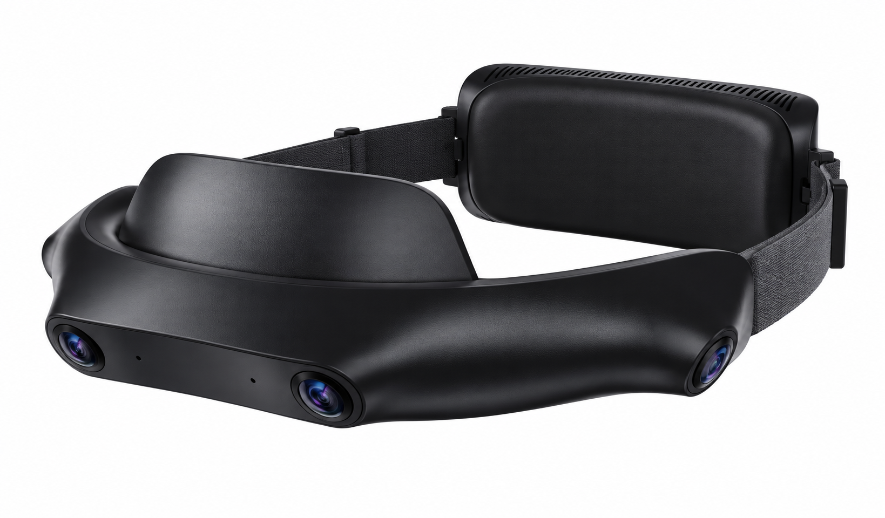

# SynerMind Ego 4 用户指南

> **文档状态：评审初稿，内容待核验。** “待确认”项需核实后才能作为正式用户说明。

[用户指南首页](index.md) · [English](../en/index.md)

*产品外观参考草图，最终外形以交付设备为准。*

按你现在要做的事情，直接进入对应页面。

| 我想…… | 从这里开始 |
| --- | --- |
| 第一次使用设备 | [完成首次采集](quick-start.md) |
| 准备开始今天的采集 | [日常采集](recording.md) |
| 取出、检查或上传数据 | [导出与检查](export.md) |
| 设备或数据出现问题 | [常见问题排查](troubleshooting.md) |

## 完整目录

### 快速开始

- [完成首次采集](quick-start.md)

### 设备与采集

- [认识设备](device-overview.md)
- [日常采集](recording.md)
- [设置与更新](settings-updates.md)

### 数据使用

- [导出与检查](export.md)
- [文件与数据说明](data-formats.md)

### 故障与支持

- [常见问题排查](troubleshooting.md)
- [联系支持](support.md)

### 产品参考

- [规格与兼容性](specifications.md)
- [安全与维护](safety-care.md)
